# Dogfight – F-16C, F/A-18E, F-15EX és F-22A légiharc (War Thunder stílusban)

3D légiharc-játék **Pythonban**, a [Panda3D](https://www.panda3d.org/) motorral – és ugyanez a böngészőben is játszható (lásd lent).

> ## ▶ Játék a böngészőben: **https://davidlipcs.github.io/Dogfight/**
>
> Telepítés nélkül, bármelyik gépről (iskolában is): nyisd meg a linket Chrome-ban, és kattints a
> „Felszállás a kifutóról” gombra. Minden a GitHubról töltődik be (kb. 17 MB), külső oldal nem kell hozzá.
> **Letöltés:** [Dogfight-F16.html](https://davidlipcs.github.io/Dogfight/web/dogfight-offline.html) – az egész játék
> egyetlen fájlban (kb. 22 MB). Mentsd el (jobb klikk → *Hivatkozás mentése másként*, vagy a játék menüjében a
> „Letöltés egy fájlban” link), és dupla kattintással megnyílik Chrome-ban – internet sem kell hozzá.
> Újragenerálás: `python tools/build_offline.py` (Node.js nélkül is megy).
>
> A kódja a [`web/`](web/) mappában van (Three.js), ugyanaz a repülésmodell, radar, rakéták és AI,
> JavaScriptre átírva; a gépet és a terepet a `tools/export_web_assets.py` exportálja a Python változatból.

| Fegyver | Típus | Mit tud |
|---|---|---|
| **M61A1 / M61A2 Vulcan** 20 mm | gépágyú | 6000 lövés/perc, 511 (F-16) / 412 (Hornet) lőszer, nyomjelzők, előretartás-jelző radar lockkal |
| **AIM-9M Sidewinder** | hőkövető („Fox 2”) | 2,5°-os keresőmező, 40°-os kardán, IRCCM (flare-szűrés), all-aspect, ~Mach 2,5 |
| **AIM-120A AMRAAM** | aktív radaros („Fox 3”) | datalink + inerciális középszakasz, 16 km-en „PITBULL”, lofting, ~Mach 4 |
| **ALE-47** | önvédelem | 30 flare + 30 chaff |

A böngészőben a fegyverzet a főmenüben állítható (hány AIM-9M és hány AIM-120A); alap: F-16 4× AIM-9M +
2× AIM-120A, Hornet 4× AIM-9M + 6× AIM-120A. A Python változatban: `--loadout amraam` = 4× AIM-120A + 2× AIM-9M,
`--loadout fox2` = 6× AIM-9M.

Az ellenfelek ugyanolyan F-16-osok vagy Super Hornetek (a menüben választható, vegyesen is), de a böngészős
változatban a gépük rosszabbul fordul (F-16: 7 G, Hornet: 6,3 G, lassabb orsózás), a rakétáik gyengébbek és könnyen kicselezhetők, a te rakétáid viszont
sokkal erősebbek: nehéz kikerülni őket, és közelről is eltalálnak. A pilótájuk is kicsit gyengébb: kevesebb G-t
húznak, pontatlanabbak, később veszik észre a rakétát, és csak a hatótávjuk biztonságosabb részéből lőnek. Radarral lockolnak,
rakétát és ágyút használnak, notcholnak, flare-t és chaffot szórnak.

## Dogfight Plus – újdonságok

* **Játékmódok:** Hullámok, **Párbaj 1v1**, **Túlélés** (egy élet), **Gyűrűverseny** (18 gyűrű a völgyekben, időre).
* **Kísérőgép**, **Ász** nehézség, pontszám sorozat-szorzóval, 16 kitüntetés, karrier-statisztika.
* **Hangár / Shop:** a pontokból kredit lesz – új gép (**F-15 ACTIVE**, NASA, tolóerő-vektorálással), 10 festés,
  fejlesztések (hajtómű, páncél, flare, lőszer), módok (bullet time – O, végtelen flare, óriás robbanás, lila nyomjelző),
  ellenség-adatlapok (Hírszerzés), mentés letöltése / betöltése fájlba.
* **Kamerák:** rakétakamera (U), killcam. **Napszak:** nappal, naplemente, borús, éjszaka csillagokkal.
* **Hang:** zenelejátszó (4 beépített szám + saját zene), hangos figyelmeztetések (Pull up, Missile), szél, Doppler, hangrobbanás.
* **Irányítás:** gombkiosztás átállítása, kontroller-rezgés, **érintéses vezérlés** telefonon / tableten.
* **Grafika:** minőségi szint, látószög, kondenzcsík, párakúp; **teljesítményteszt**, ami beállítja a grafikát.
* **Telepíthető app** (GitHub Pages-ről), offline gyorsítótárral.

## Plus 3 – új gépek, világtérkép, grafika

- **11 új gép Blenderben, az F-15 minőségében** (`tools/blender/build_generic.py` + `jets.py`): Su-35S, Su-57, MiG-29, MiG-31, JAS 39 Gripen, Eurofighter Typhoon, Rafale, J-20, valamint a T-6A, T-38C és T-45C gyakorlógép. Mindegyik saját festést, mozgó kormányfelületeket, behúzható futóművet és F-16 szintű kabint kapott (élő kijelzők, HUD, ülés, botkormány). A kabin minden része az üveg alatt marad.
- **Világtérkép (Helyszín → 🌍 Világtérkép…)**: a Föld bármelyik pontján lehet harcolni. A domborzat valódi (AWS Terrain Tiles), a talaj műholdkép (Esri World Imagery), a repülőtér a legsimább helyre kerül, a hordozó a nyílt tengerre. Van keresés és kész helyszínlista (Budapest, Balaton, Alpok, Grand Canyon, Fuji stb.). Internet kell hozzá.
- **Google fotórealisztikus 3D (Beállítások → Google 3D)**: a saját Google Maps API-kulcsoddal (Map Tiles API) a valódi helyszíneken a Google 3D városai és tájai jelennek meg, mint a Flight Simulatorben.
- **Grafika**: árnyékok, hullámzó, tükröződő tenger, részletes talaj közelről, több felhő, új **Ultra** fokozat (1,5× felbontás, 4K árnyék, 8K műholdkép, 2× sűrűbb terep).
- **Ellenfélválasztás**: több típust is ki lehet jelölni. Az MI a nehézségtől függően ki is tud térni a rakéták elől.

## Plus 4 – karrier, rádió, 3. világháború

- **Karrier (főmenü → 🎖 Karrier)**: toborzóiroda → felszerelés és centrifuga (7 G) → rádióórák → hátsó ülés a T-6-ban (az oktató repül, te beszélsz a toronnyal) → T-6A alapképzés toronyengedélyekkel → Air Force vagy Navy → T-38C / T-45C (hordozós leszállással) → légiharc-vizsga → szárnyavatás → légtérrendészet a Baltikumban kísérőként, majd vezérként → 3. világháború. Választható **valódi halál**: ha lelőnek és nem katapultálsz, vége a karriernek.
- **Rádió (I gomb)**: röviden megnyomva lista (szám = hívás) vagy beírás, nyomva tartva hangfelismerés (angolul, mint a valóságban: REQUEST TAXI, TALLY, FOX THREE, SPLASH ONE, BINGO…). A torony, az AWACS („Magic”), a vezér és a kísérő válaszol. A karrierben csak a már megtanult hívások élnek.
- **3. világháború**: valódi helyszínek (Baltikum, Szuvalki-folyosó, Fekete-tenger, Tajvani-szoros…), mindenki mindenki ellen – csak Európa harcol együtt; a bizalmat ki kell érdemelni. Minden nagyhatalomnak valós gépszáma és gyártása van; a sajátodat pontosan látod, a többiekét csak becsülöd. Az veszít, akinek elfogy a légiereje. Nagy csaták (akár 10 a 10 ellen) segítséggel, előléptetés, kitüntetések; őrnagytól te választod a frontot, alezredestől a több száz pilóta közül (arckép és képességek alapján) te küldöd ki a köteléket, ezredestől politikai döntések.
- **Katapultálás**: Ctrl+E kétszer. A pilóta ejtőernyővel túléli, a gép elveszik (a háborúban a gépszámból is).
- **F-35A Lightning II** a gépek között.

## Plus 5 – bázis, séta, bevetés a műveleti épülettől a naplóig

- **Belépő nézet**: a játék a repülőtéren indul, a menü a gépsor mellett áll. Harcból kilépve (Esc → Főmenü) ide érkezel vissza, nem látod, hol tartottál; csak a **Kilépés** gomb lép ki a játékból.
- **Séta a bázison** (WASD, Shift = futás, egér / nyilak = nézés, E = használ): a gépsor minden típusa ott áll, E-vel választasz gépet, a saját gépednél E = felszállás.
- **Karrier-bevetés**: a parancsot kapod, nem választod. Előbb felveszed a felszerelést (konténer), odasétálsz a géphez, beülsz, a kabinban ellenőrzöd a botot, hajtóművet, légféket, kijelzőket, fegyvert és rádiót, gurulási és felszállási engedélyt kérsz, felszállsz, teljesíted a feladatot, **visszatérsz és leszállsz**, kiszállsz, bemész a műveleti épületbe, és **kézzel írt naplót** adsz le (legalább pár mondat). A napló a pilótanaplóba kerül.
- **Riadó**: néha csak be kell szaladni a kifutó melletti gépbe és indulni, nincs kabinellenőrzés.
- **Rangok**: századostól te választod a kísérőidet (arckép és képességek alapján), őrnagytól a helyet, az időpontot és a gépet is. Alatta a vezért, kísérőt és feladatot kapod.
- **Javítások**: a T-6 kabinja (a szemmagasság hibás volt), nincs utánégető a T-6 és a T-45 gépen, rendes betonburkolat az aprón.

## A csapatod felszáll

Bevetésnél a vezéred, a kísérőid és a szövetséges gépek **a kifutón állnak előtted**, sorokban, és **előbb szállnak fel**: az első sor indul először, rádión jelentik, hogy gurulnak, és a levegőben veszik át a saját feladatukat. Te utánuk indulsz, és beéred őket. Legfeljebb 9 gép fér a kifutóra, a többi már a levegőben vár.

## Váratlan riasztás

A háborúban bármikor, bármilyen rangon **megszólalhat a riadó**: amint visszatérsz a hadműveleti központba (egy bevetés vagy egy pihenőnap után), nincs eligazítás és nincs „Indulás” gomb: a sziréna már szól, az óra fut a hangjelzés óta, és rohanni kell a gépig, felszállni, és megvédeni a bázist. A felszállásig eltelt idő számít (150 másodperc fölött a támadás kárt tesz a bázison). Néhány riasztás **csak gyakorlat**, de ezt senki nem mondja: a torony csak akkor szól, amikor a gép gurulni kezd.

## Kanyonfutam (külön mód)

A főmenüben a **Küldetés** sorban a **Kanyonfutam**: alacsony repülés egy szoros völgyben (a Grand Canyonban, ha nincs más világtérkép kiválasztva), kapuk a völgy fenekén, a végén egy célpont, utána meredek kihúzás a gerincen át. **2:15 alatt** kell teljesíteni. 350 m fölött a radar meglát: 4 másodpercenként +5 s büntetés. A pálya mindig ugyanaz az adott térképen (a domborzatból számolódik), így az idők összehasonlíthatók; a rekordot a böngésző őrzi. Szabad játékban, a karrier nélkül játszható.

## Légtérrendészet: nem mindig ugyanaz a feladat

A hadnagyi Baltikum-bevetések változatosak. Az AWACS csak „ismeretlen gépet” jelent, hogy mi van valójában, az azonosítás után derül ki:
- **Idegen vadász**: mellé repülsz (600 m, 8 s), azonosítod, rádión **kikérdezed** (`UNKNOWN AIRCRAFT IDENTIFY`). Vagy válaszol és fordul, vagy hallgat, és akkor `FOLLOW ME`, majd kikíséred.
- **Bajba jutott személyszállító**: eltévedt, kevés az üzemanyaga. Kikérdezed, utasítod (`FOLLOW ME`), és **a leszállópályáig kíséred**, amíg földet nem ér. Rálőni tilos.
- **Támadó**: nem válaszol, rád fordul. Tűzparancs csak akkor van, ha ő lő (rakétát indít, radarral befog, vagy elég sokáig támad); előtte `REQUEST WEAPONS FREE` kérésre az AWACS visszautasít, és ha lelövöd, hadbíróság. Utána viszont a vezéred is, te is lőhettek.

Az új hívások a 3. rádióórán tanulhatók (`radio7`).

A harcokban egyszerre legfeljebb 4 ellenség van; a többi **erősítésként** érkezik, ha az első csoport meggyengült (vagy 70–90 másodperc után).

## Oktatás (nem kötelező)

A főmenü **Oktatás** gombja egy vezetett repülést indít a kiválasztott géppel. 11 lecke, mindegyik elmagyarázza,
**mit** csinál az adott funkció, **hogyan** használod és **mikor** érdemes, aztán kipróbálod (a játék magától
észreveszi, ha sikerült): egeres repülés, gáz és utánégető, G és energia, kabin és kijelzők, radar lock +
AIM-120 egy távoli céldrónra, AIM-9 közelről, gépágyú, védekezés egy rád lőtt rakéta ellen, F-16-on az extrém
mód és a Cobra (Hornet: nagy állásszög), végül a harci zóna és a leszállás. A drónok nem lőnek vissza, és a
lövések az oktatás alatt nem sebeznek. Enter = lépés kihagyása, Esc = kilépés.

## F-16: extrém mód (tolóerő-vektorálás) és Cobra

Az F-16-on a **Tab** bekapcsolja az EXTRÉM módot – mint a kísérleti F-16 MATV / VISTA-n, a fúvócső ±20°-ot fordul:

* az egeres segítő is kihúzza a **9 G**-t, a gép tovább tartja (mérve: 9 G-ben 4,1 s a normál 2,6 s helyett),
  32°-os állásszög, gyorsabb orsózás (330°/s), több tolóerő, kis sebességen is irányítható;
* **Cobra:** 600 km/h alatt teljes húzás (S, vagy kabinban a bot teljesen hátra) – a gép 0,8 s alatt 80°-os
  állásszögbe ágaskodik, és gyorsan lassul. Ha egy rakéta ekkor **3–4 másodpercen belül** van (a piros
  rombusz mutatja), ~90% eséllyel elveszít; túl korán csinálva a rakéta újracéloz.

Ezzel az F-16 a közelharcban erősebb a Super Hornetnél, akkor is, ha a Hornet több rakétát visz.

**Ellenséges rakéták:** az ellenség csak közelről lő – normál nehézségen AIM-120-szal legfeljebb 8 km-ről,
AIM-9-cel 4,5 km-ről (nehéz: 10 / 5,5 km, könnyű: csak AIM-9, 3,5 km) –, te pedig a radarral sokkal messzebbről
lockolhatsz (T, F-16: 55 km, Hornet: 70 km). Ha egy ellenség lock-távolságon belül van, a jelölője alatt
megjelenik a „T = lock” felirat.

## Negyedik gép: F-15EX Eagle II

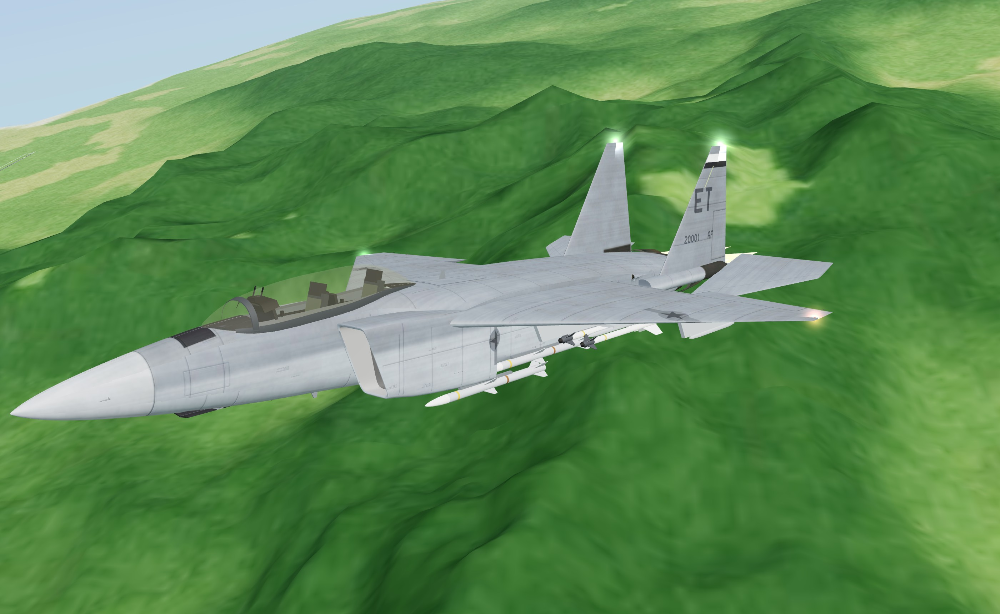

Blenderben, szkriptből ([tools/blender/build_f15.py](tools/blender/build_f15.py), `f15_shape.py`, `f15_paint.py`):
19,4 m hosszú, nagy, magasan ülő 45°-os szárny, szögletes oldalsó szívócsatornák, farokgerendákon két függőleges
vezérsík és csupa-mozgó stabilizátor, két kerek F110 fúvócső, kétüléses buborék-kabintető (mindkét ülés a tető
alatt), nagy hátsó légfék (B), „Mod Eagle” kétszínű szürke festés ET farokkóddal. Kabin: a nagy érintőképernyő
(két élő fél: RDR / SMS és SA / ENG / RWR, J / K) és az UFC adatsor.

**Az F-16-hoz hasonló:** ugyanaz a hajtómű (2× F110-GE-129, 263 kN), 9 G, tolóerő/tömeg 1,31 (F-16: 1,20),
tartós forduló 3 km-en M0,6-nál 5,6 G / 15,7°/s (F-16: 5,3 G / 14,9°/s), végsebesség M1,18 / M1,89. A rakéták
kívül vannak, mint az F-16-on: két szárnypilon oldalanként (a belsőn két sín) és AIM-120-ak a konform
póttartályokon – alapból 4× AIM-9M + 4× AIM-120A, a menüben akár 12 rakéta. Nagy radarjel (messziről látják),
APG-82 AESA radar (110 km).

| | |
|---|---|
| 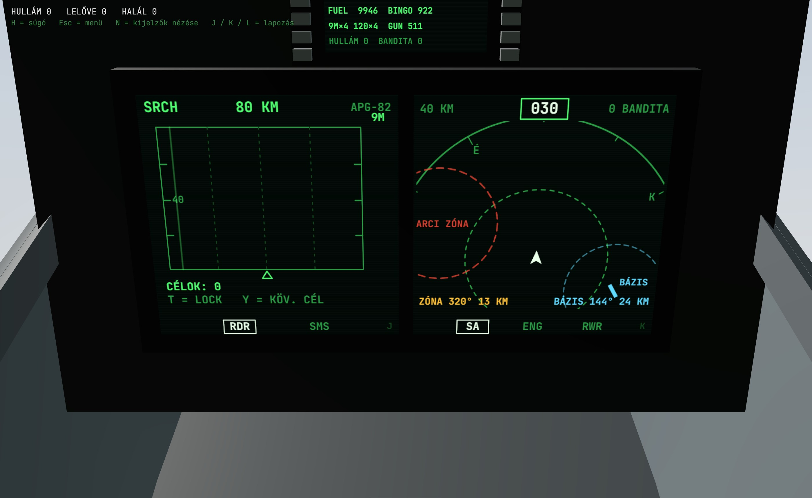 | 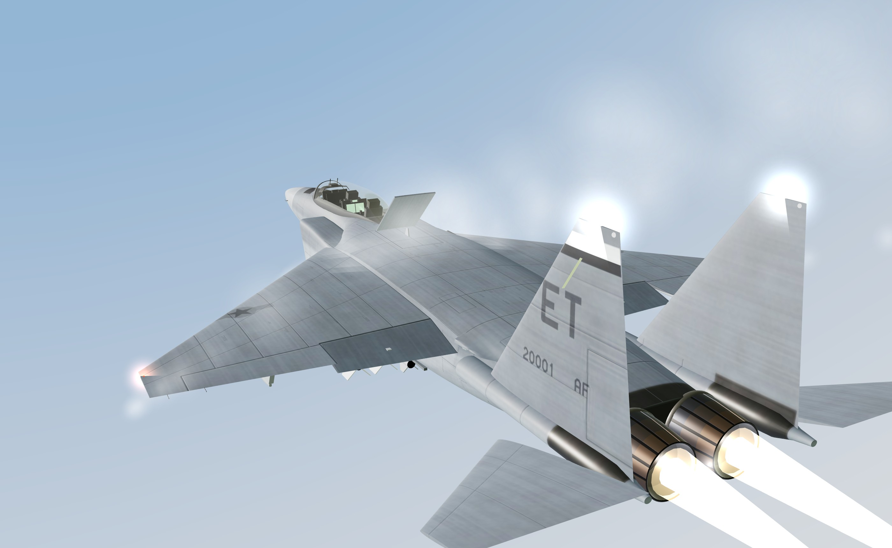 |

## Harmadik gép: F-22A Raptor

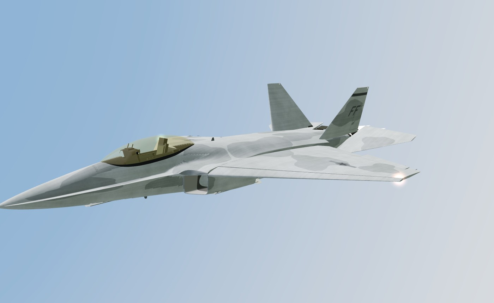

Blenderben, szkriptből ([tools/blender/build_f22.py](tools/blender/build_f22.py), `f22_shape.py`, `f22_paint.py`):
gyémánt alakú szárny (42° / −17°), éles élű (chine) orr, ferde szívócsatornák, 28°-ban döntött kettős vezérsík,
lapos, **mozgó tolóerő-vektoros fúvócsövek**, aranyszínű egyrészes buborék-kabintető, kétszínű szürke „Have Glass”
festés fűrészfogas ajtóélekkel, 6 kijelzős üvegkabin. Menüben választható saját gépnek és ellenfélnek is.

* **8 rakéta, mind belül:** 6 AIM-120 a hasi fegyvertérben, 1–1 AIM-9 az oldalsó terekben (a fegyverzet a
  menüben állítható). **Kilövéskor animáció:** kinyílik az ajtó, a kar kitolja a rakétát (az AIM-120-at
  trapéz-kar lefelé, vízszintesen tartva; az AIM-9-et a sín kifelé-lefelé), a rakéta leold, a kar visszahúzódik,
  az ajtó becsukódik – kb. 0,7 s késéssel indul a rakéta.
* **Lopakodó:** apró radarkeresztmetszet, ezért sokkal nehezebb belockolni: egy F-16 radarja kb. 8 km-ről látja
  (egy másik F-16-ot 55 km-ről). Nyitott fegyvertér-ajtónál egy pillanatra jól látszik a radaron. Hidegebb
  kiáramlás: a hőkövetők is nehezebben fogják.
* **Jobb radar:** AN/APG-77 AESA – 120 km keresés, 100 km lock, gyorsabb pásztázás és lock, és „csendes” (LPI):
  az ellenfél RWR-je csak akkor jelez, ha lockolsz.
* **2 × F119:** 312 kN, tolóerő/tömeg 1,28, utánégető nélkül is szuperszonikus (11 km-en M1,45), max M2,3;
  a tolóerő-vektorálás mindig be van kapcsolva; a gép **legfeljebb 8 G-t** húz.

| | | |
|---|---|---|
| 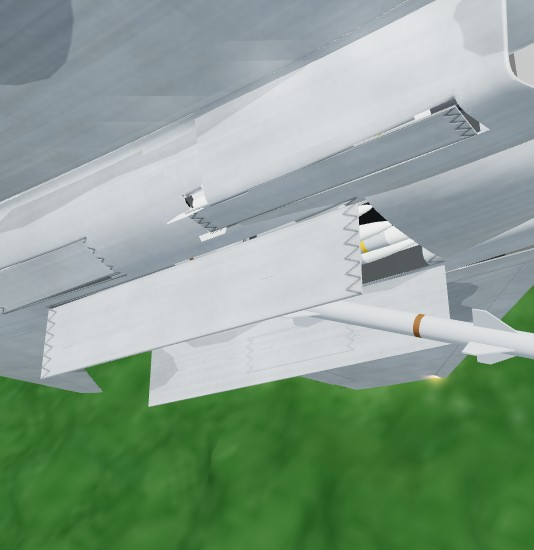 | 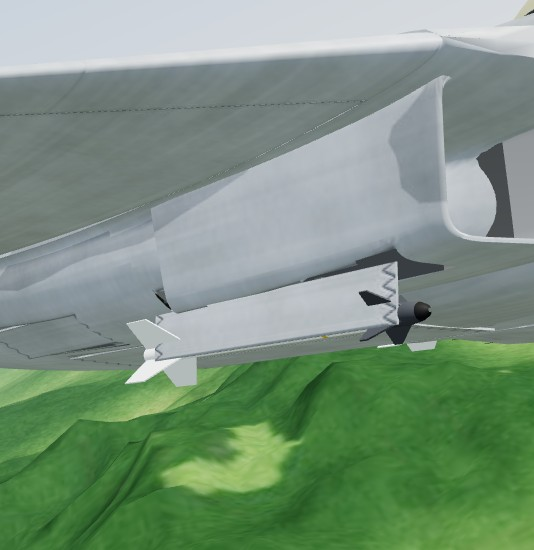 | 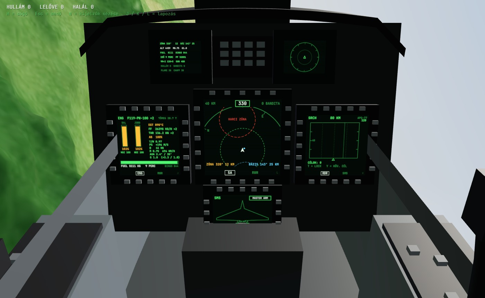 |

## Második gép: F/A-18E Super Hornet

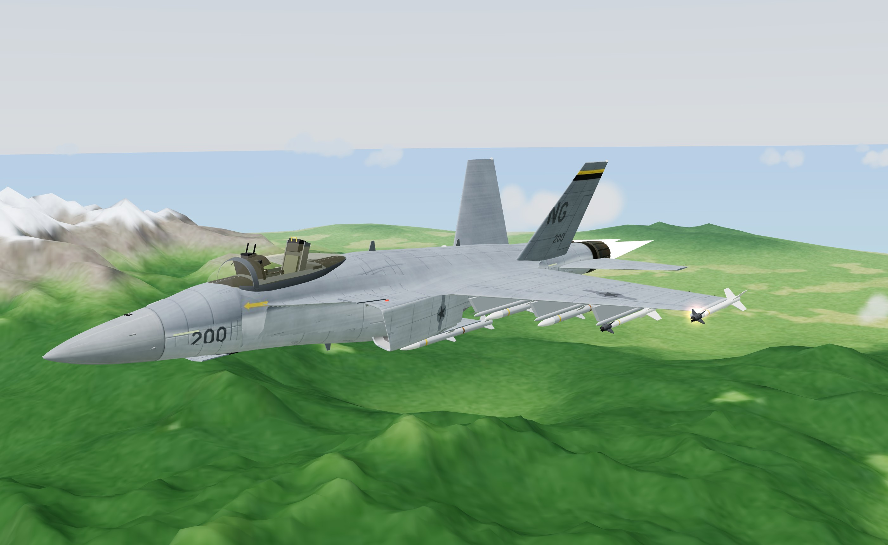

A főmenüben kiválasztható a saját gép (**F-16C Viper** vagy **F/A-18E Super Hornet**), az ellenfél típusa
(F-16C, F/A-18E vagy vegyes) és a **fegyverzet**: hány AIM-9M és hány AIM-120A legyen a gépen. A rakéták
úgy kerülnek a függesztési pontokra, ahogy az igazi gépen (a menü mutatja, melyik állomásra mi jut).

A Super Hornet is Blenderben, szkriptből épült ([tools/blender/build_fa18.py](tools/blender/build_fa18.py),
közös eszközök: `aircraft_lib.py`, alak: `fa18_shape.py`, festés: `fa18_paint.py` → `web/assets/fa18.glb`):
valós méretek (18,3 m hossz, 13,6 m fesztáv), US Navy kétszínű szürke festés (NG / 200, VFA-jelzések),
két F414 fúvócső, LEX, döntött kettős függőleges vezérsík, 11 függesztési pont, behúzható futómű aknákkal.
Mozgó felületek: orrsegédszárny, fékszárny, csűrő, stabilizátor, **két oldalkormány**, LEX-spoiler
(légfékként a kormányok kifelé, a csűrők fel, a LEX-spoilerek ki; felszálláskor a kormányok befelé állnak).

| | | |
|---|---|---|
| 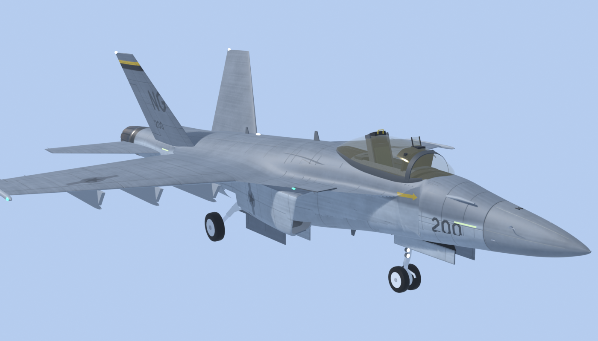 | 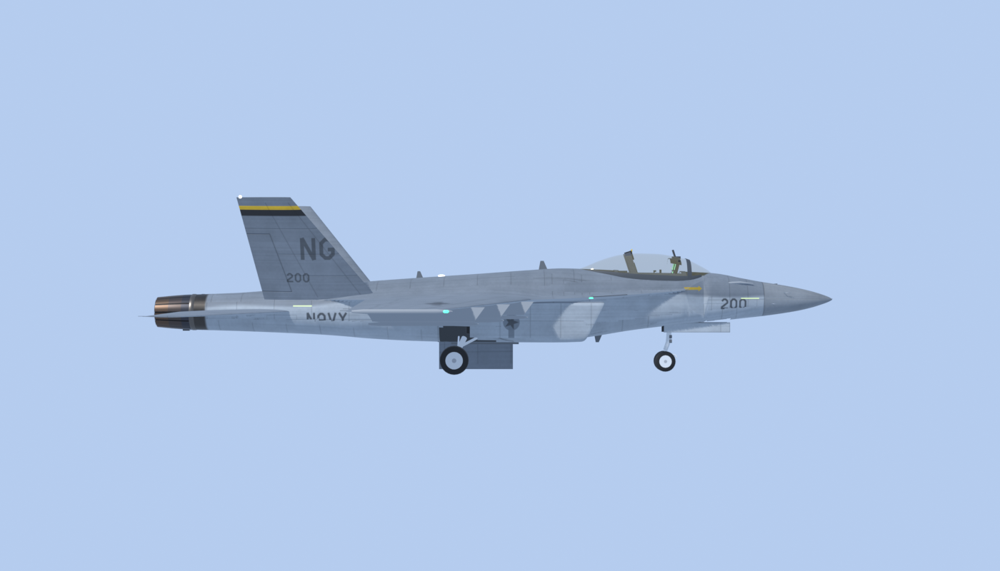 | 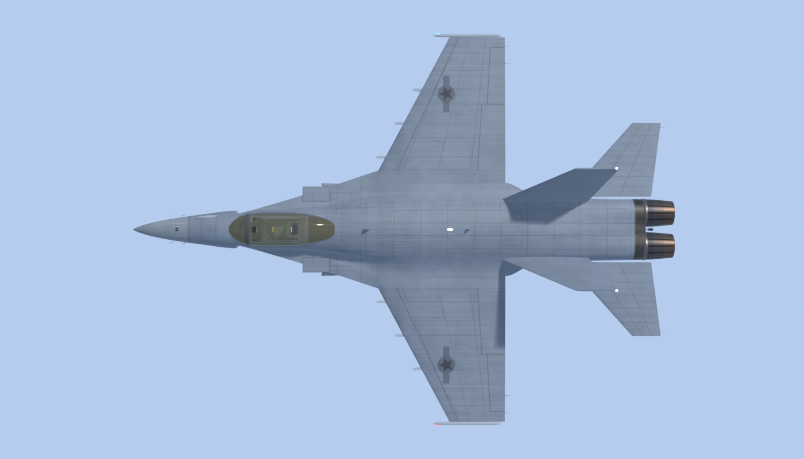 |

**Saját kabin:** a Hornet pilótafülkéje a modell része: NACES katapultülés, keretes szélvédő, HUD, két DDI,
UFCD és középen a nagy AMPCD – mind élő kijelző.

### Kabinkijelzők (mindkét gépben)

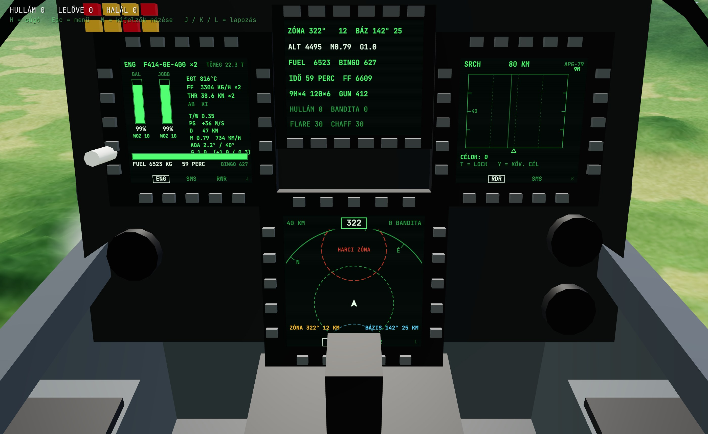

A HUD és az alap kijelzések megmaradnak; a kabin kijelzői **ennél több** információt adnak:

* **RDR** – radar B-scope: célok magassággal és irányvektorral, lockolt cél adatai (távolság, közeledés,
  magasság, Mach, aspektus, **NCTR: a cél típusa**), DLZ-csík (Rmax / no-escape / Rmin).
* **SA** – helyzetkép-térkép (orr felfelé): ellenségek, rakéták, RWR-irányok, a **harci zóna** és a bázis
  biztonsági köre, irány és távolság mindkettőhöz.
* **SMS** – fegyverzet: gép-felülnézet az állomásokkal, mi van fent, mi van kiválasztva, lőszer, flare / chaff.
* **ENG** – hajtómű(vek): fordulatszám, fúvócső, EGT, üzemanyag-fogyasztás, tolóerő; teljesítmény:
  **tolóerő/tömeg, fajlagos többletteljesítmény (Ps)**, ellenállás, G-tartomány; üzemanyag, hátralévő idő, BINGO.
* **RWR** – fenyegetések és a rád tartó rakéták távolsággal.
* **DED / UFCD** – adatsor: zóna és bázis iránya, üzemanyag, fegyverek, hullám.

Kabinban **N** = lenézés a kijelzőkre (ráközelít, olvasható), újra N = vissza; **J / K / L** = a bal / jobb /
középső kijelző lapozása.

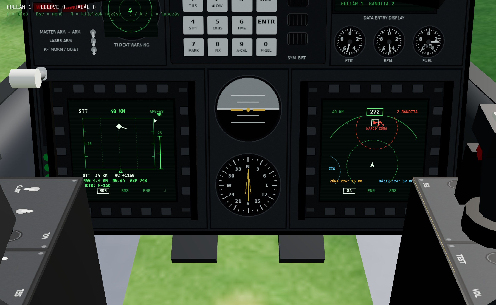

### Harci zóna

A harc a térkép **túloldalán**, a harci zónában zajlik (a HUD-on borostyán jelölő, a térképen piros kör).
A bázis körüli **14 km-es biztonsági körben** az ellenség nem támad, és csak a zónában (+12 km) lévő célokra
megy rá: felszállás és leszállás közben nyugton hagynak. Levegőben indulva a zóna szélénél kezdesz.

## A gép (F-16C)

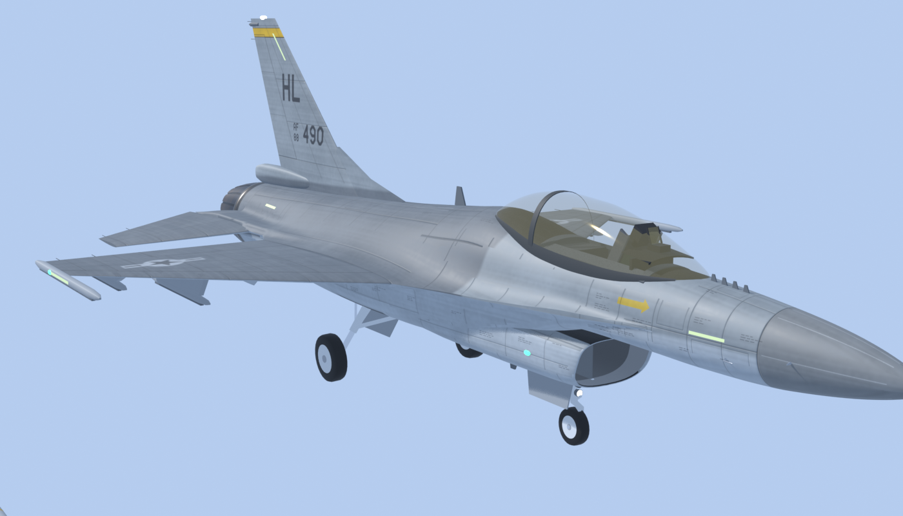

A böngészős változatban a gép kívülről egy **Blenderben, szkriptből épített** modell
([tools/blender/build_f16.py](tools/blender/build_f16.py) → `web/assets/f16.glb`): valós méretek (15,03 m hossz),
kb. 70 ezer háromszög, panelvonalas festés normal- és roughness-térképpel, külön mozgó kormányfelületek,
futómű, részletes fúvócső, valamint AIM-9M és AIM-120 rakéták. A pilótafülke-nézet és a Python változat
továbbra is az alábbi, kódból épített modellt használja:


Részletes, valódi méretekből kódból épített F-16C Block 50 (nem kell hozzá külső 3D fájl):

* **forma:** a szárnyba simuló törzs (blended wing-body) éles szárnytő-kiterjesztéssel (LERX),
  NACA szárnyprofilok, kifelé dőlő hasúszók, fékernyő-konténer, alsó szívócsatorna a belsejéig,
  szirmos F110-fúvóka lángtartóval, pitot-cső, „bird slicer" IFF-antennák, pilonok, LAU-129 sínek
* **mozgó kormányfelületek:** a stabilizátorok húzásra és orsózásra, a flaperonok orsózásra
  és fékszárnyként, az oldalkormány, a belépőél-orrsegédszárny az állásszöggel, és a fúvóka melletti
  kagyló-légfékek (B) – mind valódi csuklótengely körül, korlátozott sebességgel mozognak
* **kabin:** magas, enyhén aranyszínű buborék-kabintető kerettel és visszapillantó tükrökkel; alatta valódi
  kabinkád: 30°-ban hátradöntött ACES II katapultülés (sárga-fekete katapultfogantyú, hevederek),
  oldalkonzolok kapcsolókkal, oldalsó botkormány és gázkar, műszerfal két világító MFD-vel (radar és
  fegyverállapot), DED kijelző, ICP billentyűzet, tartalék műszerek, takaróernyő és HUD. A kabinnézetben (V)
  a saját gép külön, közeli renderelési menetben rajzolódik, így a műszerfal nem vágódik le.
  Pilóta szándékosan nincs a gépben
* **festés:** a valódi F-16 háromszínű szürke sémája (sötét gerinc, középszürke oldalak és szárnyak,
  világos has), panelvonalak, szegecsek, árnyékolás a csatlakozásoknál, koromnyomok,
  USAF felségjelek, farokkód és gyári szám (egy „aggressor" sivatagi terepszín is készül, de most az ellenség
  is a szürke festést kapja)
* **fények:** formációs fénycsíkok, helyzetjelző fények, villogó stroboszkóp
* **effektek:** nagy állásszögnél páracsóva a szárnytő-kiterjesztésből, 9 G közelében szárnyvég-örvények

Közelről a részletes modell, 2,5 km-en túl egy egyszerűbb változat látszik (LOD), így gyors marad.

| | |
|---|---|
|  |  |
|  |  |
| 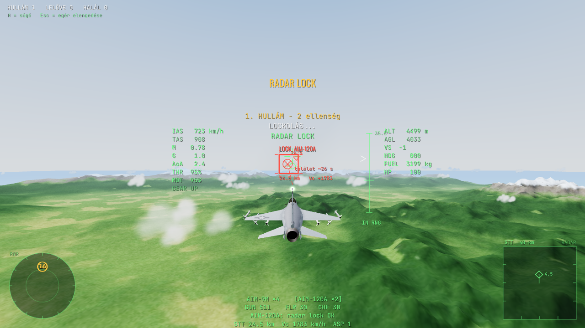 | 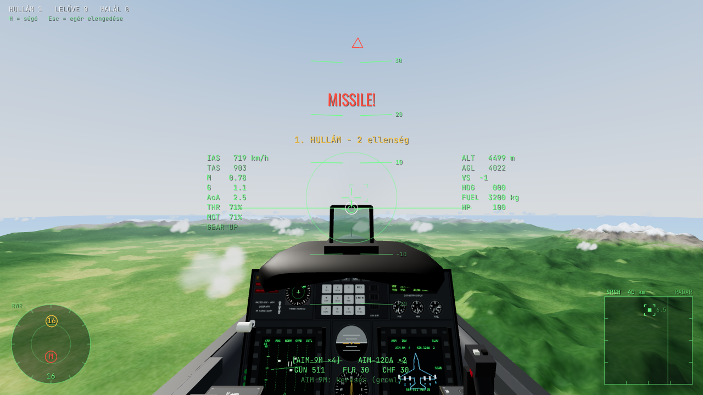 |

## Telepítés és indítás

Python 3.9+ kell (Panda3D + numpy).

```bash
pip install -r requirements.txt
python main.py
```

Hasznos kapcsolók (`python main.py --help`):

```bash
python main.py --difficulty hard --enemies 3     # nehezebb AI, több ellenség
python main.py --fullscreen --size 1920x1080
python main.py --loadout amraam                  # 4 AMRAAM
python main.py --sensitivity 0.06 --invert-y     # egér beállítások
python main.py --clouds 20 --no-aa --no-shaders  # gyengébb gépre
python main.py --air-start                       # levegőben indulás, felszállás nélkül
```

## Játékmódok

* **Arkád** (alapértelmezett, `--mode arcade`): minden kilőtt rakéta 10 s múlva magától visszakerül a sínre
  (a HUD alján látszik: `AIM-9M x3 +1 (7s)`), a gépágyú lőszere és a flare / chaff pedig 2 s szünet után
  10 s alatt tölt fel újra.
* **Realisztikus** (`--mode realistic`): újratöltés csak leszállás után – a bázis betonján lelassulva azonnal
  újrafegyvereznek, tankolnak és megjavítanak.

Minden rád kilőtt rakétánál (a hőkövetőknél is) szól a rakétaközelítés-jelző: egyre gyorsuló sípolás, „MISSILE!”,
piros jel a rakétán a távolsággal és a becsapódásig hátralévő idővel, az RWR-en `M`.

## Kontroller (Xbox / PlayStation)

Csak dugd be (vagy kapcsold be Bluetooth-on), a játék magától felismeri. A menüben **A** = felszállás a kifutóról,
**X** = indulás a levegőben.

| Gomb | Funkció |
|---|---|
| Bal kar | a gép közvetlen irányítása (hátra = orr fel, oldalra = orsózás) |
| Jobb kar | a célzókör mozgatása, mint az egérrel (az egeres segítő repül oda) |
| RT / LT | gáz fel / le (100%-nál megáll, újra RT = utánégető) |
| RB / A | gépágyú / rakéta |
| X / B / Y | radar lock / hőkövető lock / fegyverváltás |
| LB | flare + chaff |
| D-pad | fel: futómű, le: fék / légfék, bal: kabin / külső nézet, jobb: zoom |
| L3 (tartva) / R3 | körülnézés a jobb karral / célpont-jelölők |
| Start / Back | szünet / súgó |

## Irányítás

| Billentyű | Funkció |
|---|---|
| **Egér** | (érzékenység: főmenü / Esc → „Egér célzás” és „Botkormány” csúszka, 5–200%) külső nézetben a gép orra a fehér körre áll; kabinnézetben (V) az egér a botkormány: előre tolva orr le, magad felé húzva orr fel, oldalra orsózás. A bot ott marad, ahová teszed (nem rugózik vissza), középen kis holtsáv, a semleges állást zöld pont jelzi |
| S / W | orr fel / orr le kézzel: amíg nyomod, az egeres segítő elengedi a gépet, a célzókör az orron marad (mint a War Thunderben); az S a teljes 9 G-t is kihúzza, az egeres segítő ~7,6 G-nél megáll |
| A / D, Q / E | csűrő, oldalkormány kézi felülbírálása |
| Shift / Ctrl (böngészőben Z is) | gáz fel / le: koppintás = 5%, tartva folyamatos. 100%-nál (MIL) megáll, ott még egy **Shift** = **utánégető**; lefelé az első nyomás kikapcsolja |
| **G** | futómű ki / be |
| B (tartva) | a földön **kerékfék**, a levegőben légfék |
| C vagy jobb egérgomb (tartva) | szabad körülnézés |
| Z (tartva) | zoom |
| **N** / **J K L** | kabinban: kijelzők nézése (ráközelít) / a bal, jobb, középső kijelző lapozása |
| **Tab** | F-16: extrém mód (tolóerő-vektorálás, 9 G, Cobra) be / ki |
| V | kabin / külső nézet. A kabin a géppel együtt mozog (orsózik, bólint), G alatt a fej lesüllyed, nagy G-nél elsötétül a kép, negatív G-nél bevörösödik |
| **Bal egérgomb** | gépágyú |
| **Space** | rakéta indítása |
| Egérgörgő | fegyverváltás (a következő / előző rakétatípus) |
| 1 / 2 | AIM-9M / AIM-120A kiválasztása |
| X (tartva) | flare + chaff |
| R | radar be / ki |
| **T** | radar **lock** arra az ellenségre, amerre nézel (±30°); újra T: következő cél, ha nincs más: unlock |
| **F** | AIM-9M **lock** / elengedés (ha a keresőben nincs semmi: a legforróbb ellenség ±30°-on belül) |
| Y | következő radarcél kijelölése |
| M | célpont-, harci zóna- és bázisjelölők ki/be |
| H vagy F1 | súgó (szünetelteti a játékot) |
| P | szünet |
| Esc | menü: Folytatás, Főmenü (új játék, beállítások – onnan a Folytatással vissza a meccsbe), Súgó |
| Enter | újraéledés, ha lelőttek |

## Felszállás és leszállás


A játék a **Viper Base** légibázis 36-os pályájának elején kezdődik (3000 × 45 m-es pálya
ICAO-jelzésekkel, gurulóút, betonfedezékek, irányítótorony, parkoló F-16-osok és Super Hornetek, pálya- és
megközelítési fények). Az ellenség csak a felszállás után érkezik, és a térkép túloldalán, a harci zónában vár;
a bázis 14 km-es körében nem támad.

**Felszállás**
1. Tartsd a **Shift**-et: a gáz 100%-nál (MIL) megáll, ott még egy **Shift** = utánégető. A hajtómű pár
   másodperc alatt pörög fel (a HUD-on `THR` a gázkar, `MOT` a hajtómű).
2. ~**250–280 km/h**-nál emeld meg az egeret (vagy nyomd az **S**-t): a gép felemeli az orrát.
   Vigyázz, 13° felett a farok a betonhoz ér (farokütés)!
3. ~**320 km/h** körül elemelkedik (utánégetővel kb. 450 m nekifutás, katonai teljesítménnyel kb. 700 m).
   A Super Hornet nehezebb: ~300–360 km/h-nál emelkedik el, utánégetővel álló helyzetből ~16 s alatt.
4. **G** = futómű be. Kiengedett futóművel ne menj 550 km/h fölé (GEAR SPEED).


**Leszállás**
1. **G** = futómű ki (4 s, a HUD-on `GEAR DOWN`). A fékszárnyak a futóművel együtt lejönnek.
2. Közelíts ~**270 km/h**-val, lassú süllyedéssel, vízszintes szárnyakkal.
3. Földet érés: süllyedés **< 4 m/s**, bedöntés < 12°. Különben eltörik a futómű / leér a szárnyvég.
4. A földön **B** = kerékfék (a gép kb. 700 m alatt áll meg), az egérrel/Q-E-vel kormányzol (orrkerék).
5. A bázis betonján **lelassulva** (25 m/s alatt) azonnal újrafegyvereznek, tankolnak és megjavítanak.

## Hogyan működik a lockolás? (mint a War Thunderben)

A játékos gépén **lockolást segítő mód** van (az AI-n nincs): a hőkövető kereső 10°-os körben keres
és magától lockol, a **T** pedig arra az ellenségre lockol, amerre nézel.

### AIM-9M Sidewinder (hőkövető)
1. Válaszd ki: **1** (vagy görgő). A HUD-on megjelenik egy nagy kör – ez a rakéta **keresőfejének**
   látómezeje. Közben hallod a halk „morgást” (growl).
2. Vidd a célpontot a körbe. Ha a kereső ellenséges hőforrást lát, **magától rááll (LOCK)**, a hang
   **magas, folyamatos sípolásra** vált, és innentől a kereső magától követi – akár 40°-ra is elnézhet
   az orrtól. Az **F** azonnal lockol bármelyik ellenségre az orr előtti ±30°-ban, vagy elengedi a
   lockot (utána 3 s-ig nem lockol magától).
3. **Space** = indítás. Repülés közben a rakéta saját keresővel, arányos rávezetéssel megy a célra.

Tippek: a hátsó félgömbből és utánégetős (AB) célra sokkal messzebbről lockol (≈9–13 km),
szemből csak ≈3–4 km-ről. Ha van radar lockod, a kereső automatikusan a radarcélra fordul és lockol.
A célpont flare-jei elcsalhatják a rakétát; az AIM-9M IRCCM-je ~65% eséllyel kiszűri őket.

### AIM-120A AMRAAM (aktív radaros)
1. A radar **SRCH** módban pásztáz (±60°). A jobb alsó **B-scope** kijelzőn látod a célokat
   (vízszintesen az irány, függőlegesen a távolság).
2. **Nézz a célra** (egérrel vagy C-vel körülnézve) és nyomd meg a **T**-t: a nézési irányhoz
   legközelebbi ellenséget (±30°, 55 km-ig) negyed másodperc alatt lockolja, **STT** lesz: zöld négyzet
   a célon, távolság és közeledési sebesség (Vc). Újra **T**: a következő cél; ha nincs más, unlock.
3. Lock közben az AIM-9M keresője is a radarcélra fordul és lockol.
4. A HUD jobb oldalán a **DLZ** csík mutatja a hatótávot: `Rmax` (még elér), `NO ESC` (nem tud
   kitérni), `MIN` (túl közel). **Space** = indítás.
5. Indítás után a rakéta **datalinken** kapja a célpont helyzetét, amíg tartod a lockot. Kb. 16 km-re
   a céltól aktiválja a saját radarját: **PITBULL** – innentől elengedheted a lockot.
   Ha előtte elveszted a lockot, a rakéta az utolsó ismert pozíció felé repül és ott keres.
6. Lock nélkül is kilőheted („maddog”): ilyenkor azonnal aktív, és ami a keresőjébe kerül, arra megy.

### Védekezés
* **RWR** (bal lent): `16` = ellenséges F-16, `18` = ellenséges Hornet radar. Zöld = pásztáz, sárga = **lockolt rád**,
  piros villogó = **rakétát indítottak rád**.
* **Notch**: fordulj 90°-ra a radaros fenyegetéshez képest. A pulzus-Doppler radar kiszűri a
  közel nulla radiális sebességű célokat – kiesel a lockból. Közben szórj **chaffot** (X).
* Hőkövető ellen: **flare** (X), vedd vissza a gázt az utánégetőről, és fordulj élesen.

## Térkép


102 × 102 km-es sziget, 100 m-es felbontású domborzattal (az első indításkor ~10 s alatt generálódik,
utána a gyorsítótárból azonnal betölt):

* **észak:** hosszú, havas hegylánc, 3000–4400 m-es csúcsokkal
* **kelet:** nagy, különálló hegytömb (~3200 m)
* **nyugat és közép:** közepes, erdős hegyek (1000–2000 m), völgyek, egy tó
* **dél:** dombok és kisebb hegyek (200–900 m) – itt indulsz, észak felé
* körben tagolt partvonal, a szigeten túl nyílt tenger


## Repülésmodell

Mindkét gép ugyanazzal a repülésmodellel repül, a különbség csak a valós adatokban van (`web/js/specs.js`):

| | F-16C Block 50 | F/A-18E Super Hornet |
|---|---|---|
| Hajtómű | 1× F110-GE-129: 76 / 132 kN | 2× F414-GE-400: 2× 58 / 2× 98 kN |
| Üres tömeg / belső üzemanyag | 8 900 / 3 200 kg | 14 552 / 6 530 kg |
| Szárnyfelület | 27,9 m² | 46,5 m² |
| Tolóerő/tömeg (50% üzemanyag, rakéták) | 1,20 | 1,05 |
| Végsebesség tengerszinten / 11 km-en (rakétákkal) | M1,18 / M1,88 | M1,0 / ~M1,4 |
| Emelkedés tengerszinten | ~320 m/s | ~230 m/s |
| Max G / AoA-limit | 9 G / 25° | 7,5 G / 40° |
| Tartós forduló 3 km, M0,6 | 5,3 G, 14,9°/s | 5,0 G, 14,1°/s |
| Pillanatnyi forduló 3 km, 600 km/h | 5,8 G, 19,2°/s | 6,3 G, 20,9°/s |
| Utánégetővel ennyi ideig bírja | ~7,4 perc | ~10,6 perc |

A Hornet több szárnnyal és a LEX-szel lassan jobban fordul és messzebbre fordítja az orrát (nagy állásszög),
de nehezebb, nagyobb az ellenállása (a döntött pilonok is), ezért lassabban gyorsul és hamarabb elveszti az
energiáját – mint az igazi.

Az F-16C Block 50 (F110-GE-129, 4× AIM-9M + 2× AIM-120A) részletes értékei (a Python változattal mérve):

| | Modell | Valódi F-16C |
|---|---|---|
| Végsebesség tengerszinten (utánégető) | 1455 km/h, M1,19 | ~M1,2 |
| Végsebesség 11 km-en | 2007 km/h, M1,89 | M1,8–2,0 (rakétákkal) |
| Katonai teljesítmény, 9 km | M1,0 | nem tud szuperszonikusan cirkálni |
| Gyorsulás 300→600 csomó, tengerszint | 16 s | |
| Emelkedés 10 km-re | ~80 s | ~1,5 perc |
| Plafon | ~16 km | 15,2 km (50 000 ft) |
| Tartós forduló alacsonyan | 9 G, ~21°/s | 18–21°/s |
| G-felépülés 1→8,5 G | ~1 s | ~9 G/s |
| Hajtómű: alapjárat → katonai | ~4 s | ~4 s |
| Felszállás utánégetővel | 450 m, 179 kt | ~450 m, 150–180 kt |
| Felszállás katonai teljesítménnyel | 700 m, 163 kt | |
| Leszállás (földet érés / kifutás fékkel) | 241 km/h / ~710 m | ~240–270 km/h / 750–1000 m |
| Utánégető begyújtás → max | ~1,5 s | 1–2 s |

* **Légkör:** ISA 0–32 km (sűrűség, hangsebesség) – fent kevesebb a felhajtóerő és a tolóerő,
  11 km felett a tolóerő gyorsabban csökken, ezért kb. 16 km a plafon.
* **Hajtómű:** valósághű, késleltetett felpörgés (alapjáraton lassú), magasság- és Mach-függő tolóerő,
  üzemanyag-fogyasztás (utánégetővel ~8 kg/s!).
* **Fly-by-wire (FLCS):** a botkormány **G-t** kér (semleges = 1 G, max **9 G**, min −3 G),
  a G-felépülés ~10 G/s-ra korlátozott, **25°-os AoA-limiter**, ~270°/s orsózás.
  A nagy G-s forduló **energiát (sebességet) emészt**, lassan nem tudsz 9 G-t húzni (sarok-sebesség ~750 km/h).
* **Futómű és földi fizika:** gördülési ellenállás (beton / fű), kerékfék, orrkerék-kormányzás,
  elforgatás csak elég légsebességnél, farokütés, kemény / ferde / futómű nélküli földet érés = baleset,
  a futómű a földön nem húzható be, kiengedve ellenállást ad, a fékszárnyak ~240 csomó felett felhúzódnak.
* **Aerodinamika:** Mach-függő felhajtóerő, transzonikus ellenállás-növekedés M0,88-tól, indukált ellenállás.
* **Egeres irányítás (War Thunder-féle instruktor):** a böngészőben a gép **orrát** viszi a fehér körre (a
  Python változatban a repülési pályát), gravitáció-kompenzációval. A kért fordulási sebesség a szöggel arányos, ezért a kis korrekciók
  finomak: kevés bedöntés + oldalkormány. A kicsit lejjebb lévő célhoz negatív G-vel lenyom (nem fordul
  hátára), a húzás/nyomás választásnak hiszterézise van (nem billeg). A játékosnál ~7,6 G-nél megáll
  (az S-sel kihúzható a 9 G). Amíg W/S/A/D-t nyomsz, elengedi a gépet, a célzókör pedig az orron marad.
* **G-hatások:** 7,5 G felett tartósan elszürkül / elsötétül a kép, −1,8 G alatt bevörösödik.

Minden adat egy helyen van: böngészőben `web/js/specs.js`, Pythonban `dogfight/sim/specs.py` – itt lehet hangolni.

## Projekt felépítése

```
main.py                 indítás, parancssori kapcsolók (--mode arcade|realistic, --difficulty, ...)
dogfight/
  game.py               Panda3D alkalmazás, játékmenet (hullámok, újraéledés)
  camera.py             War Thunder-féle egeres kamera, kabin nézet
  controls.py           bemenet, játékos "instruktora"
  audio.py              kódból generált hangok (growl, lock-hang, RWR, ágyú, hajtómű)
  sim/                  szimuláció (megjelenítés nélkül, tesztelhető)
    specs.py            F-16C, AIM-9M, AIM-120A, M61A1, APG-68 adatai
    flight_model.py     aerodinamika + FLCS + futómű és földi fizika
    airfield.py         légibázis: pálya, gurulóút, kiszolgálás
    missile.py          rakéták, arányos rávezetés, datalink, pitbull, DLZ
    radar.py            SRCH / ACM / STT, Doppler-notch, chaff
    ir_seeker.py        IR keresőfej, flare-ek, IRCCM
    rwr.py              radar figyelmeztető vevő
    guns.py             gépágyú, ballisztika, találat-doboz, előretartás
    aircraft.py, world.py, terrain.py, signatures.py, countermeasures.py
  ai/                   AI pilóta + közös "instruktor" (irány -> kormánymozdulatok)
  render/               részletes F-16 (f16_model.py), kabin (cockpit.py + cockpit.png), rakéták,
                        terep (LOD), reptér, ég, effektek
  ui/                   HUD, radar B-scope, RWR, G-hatások, súgó
web/                    böngészős változat (Three.js) - ugyanaz a játék JavaScriptben
  index.html            menü, súgó, a játék oldala (GitHub Pages: /Dogfight/web/)
  js/                   util, specs, flight, terrain, weapons, sim, ai, render, glb, mfd (kabinkijelzők), hud,
                        audio, game (+ three.min.js)
  assets/               Blender-modellek (f16.glb, fa18.glb) és rakéták, az F-16 kabinnézet geometriája,
                        festések, terep, kabin-textúra
  dogfight-offline.html az egész játék egy fájlban (tools/build_offline.py készíti)
tools/
  export_web_assets.py  a Python modell / terep exportja a web/assets-be
  make_cockpit_texture.py  a kabin-textúra (műszerfal, MFD-k, konzolok) megrajzolása
  build_offline.py      egyfájlos offline változat (esbuild vagy beépített csomagoló + data: URI-k)
  blender/              Blender-szkriptek: aircraft_lib.py (közös), build_f16.py / build_fa18.py (Blenderben
                        futtatandó), *_shape.py (alak), *_paint.py (festés)
models/f16/, models/fa18/  a modellek teljes felbontásban (.glb), renderképek
tests/                  pytest tesztek (repülés, földi fizika, rakéták, szenzorok, instruktor, gázkar)
docs/                   képek + DOKUMENTACIO.md (teljes dokumentáció, fejlesztési napló)
index.html              átirányít a böngészős játékra (GitHub Pages gyökér)
```

A teljes dokumentáció (minden funkció, felépítés, karbantartás, fejlesztési napló):
**[docs/DOKUMENTACIO.md](docs/DOKUMENTACIO.md)**

Tesztek futtatása: `pip install pytest && python -m pytest`
