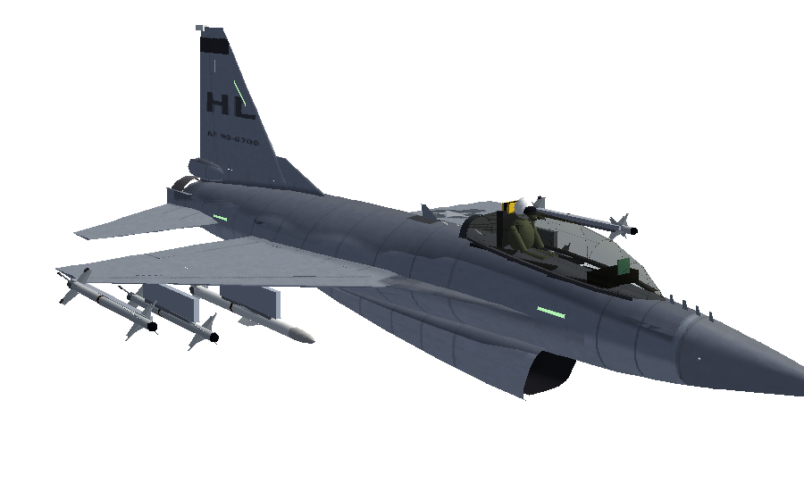
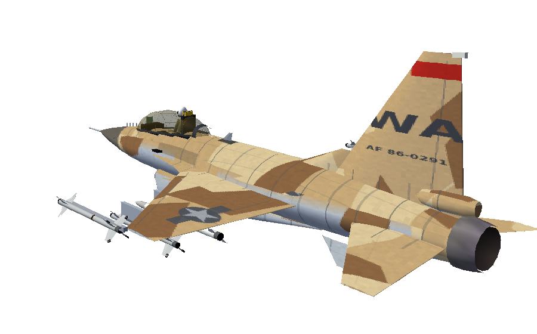
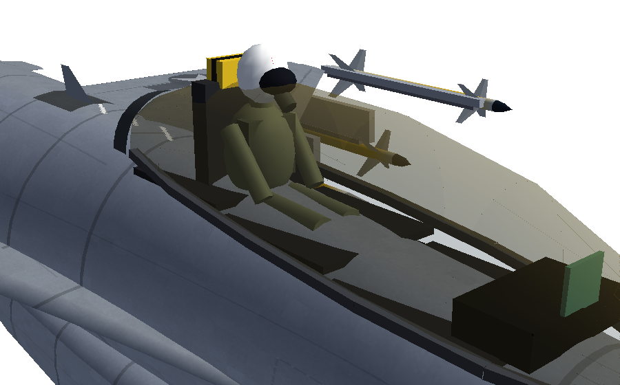
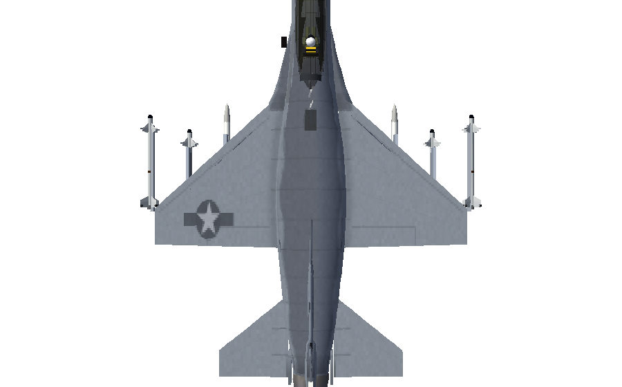
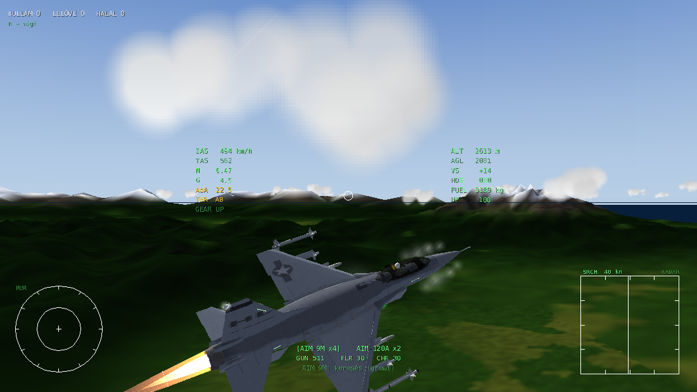
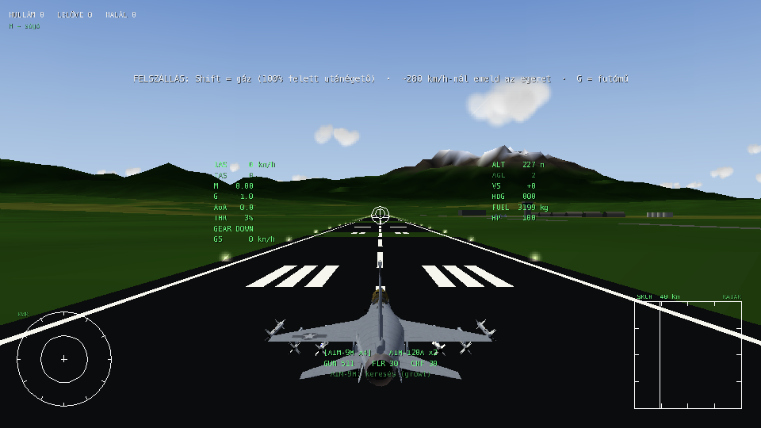
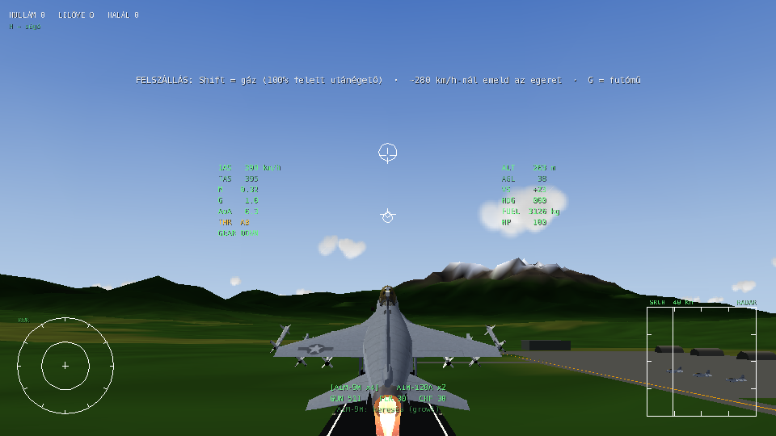
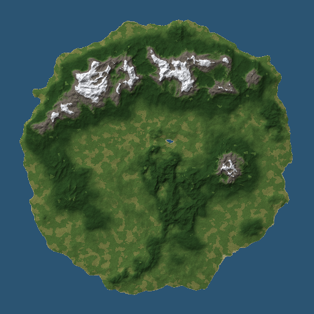
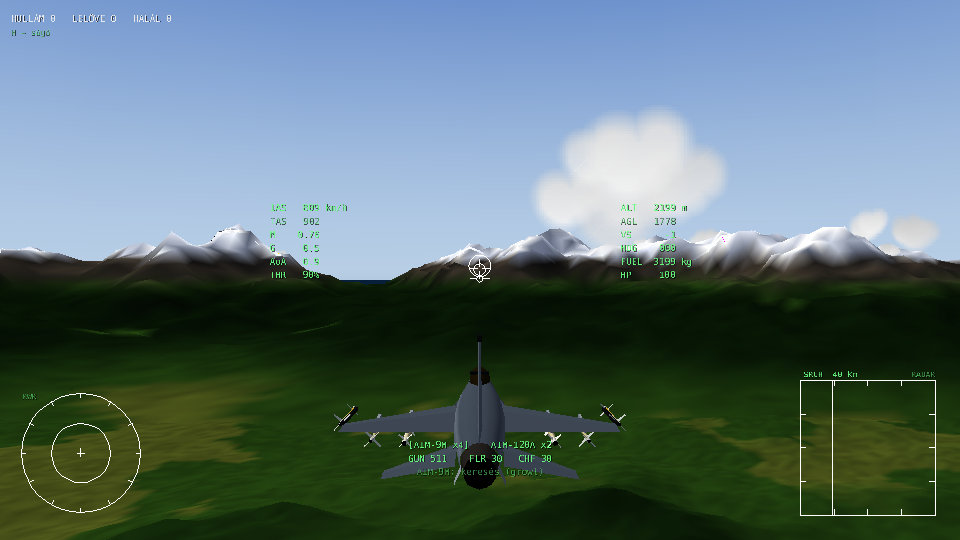

# Dogfight – F-16C légiharc (War Thunder stílusban)

3D légiharc-játék **Pythonban**, a [Panda3D](https://www.panda3d.org/) motorral – és ugyanez a böngészőben is játszható (lásd lent).

> ## ▶ Játék a böngészőben: **https://davidlipcs.github.io/Dogfight/**
>
> Telepítés nélkül, bármelyik gépről (iskolában is): nyisd meg a linket Chrome-ban, és kattints a
> „Felszállás a kifutóról” gombra. Minden a GitHubról töltődik be (kb. 10 MB), külső oldal nem kell hozzá.
> **Letöltés:** [Dogfight-F16.html](https://davidlipcs.github.io/Dogfight/web/dogfight-offline.html) – az egész játék
> egyetlen fájlban (kb. 14 MB). Mentsd el (jobb klikk → *Hivatkozás mentése másként*, vagy a játék menüjében a
> „Letöltés egy fájlban” link), és dupla kattintással megnyílik Chrome-ban – internet sem kell hozzá.
> Újragenerálás: `python tools/build_offline.py` (Node.js kell hozzá).
>
> A kódja a [`web/`](web/) mappában van (Three.js), ugyanaz a repülésmodell, radar, rakéták és AI,
> JavaScriptre átírva; a gépet és a terepet a `tools/export_web_assets.py` exportálja a Python változatból.

| Fegyver | Típus | Mit tud |
|---|---|---|
| **M61A1 Vulcan** 20 mm | gépágyú | 6000 lövés/perc, 511 lőszer, nyomjelzők, előretartás-jelző radar lockkal |
| **AIM-9M Sidewinder** | hőkövető („Fox 2”) | 2,5°-os keresőmező, 40°-os kardán, IRCCM (flare-szűrés), all-aspect, ~Mach 2,5 |
| **AIM-120A AMRAAM** | aktív radaros („Fox 3”) | datalink + inerciális középszakasz, 16 km-en „PITBULL”, lofting, ~Mach 4 |
| **ALE-47** | önvédelem | 30 flare + 30 chaff |

Alap fegyverzet: 4× AIM-9M + 2× AIM-120A (`--loadout amraam` = 4× AIM-120A + 2× AIM-9M, `--loadout fox2` = 6× AIM-9M).

Az ellenfelek is F-16-osok („aggressor” homokszínű festéssel), AI pilótával: radarral lockolnak,
rakétát és ágyút használnak, notcholnak, flare-t és chaffot szórnak.

## A gép



Részletes, valódi méretekből kódból épített F-16C Block 50 (nem kell hozzá külső 3D fájl):

* **forma:** a szárnyba simuló törzs (blended wing-body) éles szárnytő-kiterjesztéssel (LERX),
  NACA szárnyprofilok, kifelé dőlő hasúszók, fékernyő-konténer, alsó szívócsatorna a belsejéig,
  szirmos F110-fúvóka lángtartóval, pitot-cső, „bird slicer" IFF-antennák, pilonok, LAU-129 sínek
* **mozgó kormányfelületek:** a stabilizátorok húzásra és orsózásra, a flaperonok orsózásra
  és fékszárnyként, az oldalkormány, a belépőél-orrsegédszárny az állásszöggel, és a fúvóka melletti
  kagyló-légfékek (B) – mind valódi csuklótengely körül, korlátozott sebességgel mozognak
* **kabin:** magas, enyhén aranyszínű buborék-kabintető kerettel és visszapillantó tükrökkel; alatta valódi
  kabinkád: 30°-ban hátradöntött ACES II katapultülés (sárga-fekete katapultfogantyú, hevederek),
  oldalkonzolok kapcsolókkal, oldalsó botkormány és gázkar, műszerfal két világító MFD-vel (radar és
  fegyverállapot), DED kijelző, ICP billentyűzet, tartalék műszerek, takaróernyő és HUD. A kabinnézetben (V)
  a saját gép külön, közeli renderelési menetben rajzolódik, így a műszerfal nem vágódik le
  (sisak, napellenző, oxigénmaszk, kezek)
* **festés:** a valódi F-16 háromszínű szürke sémája (sötét gerinc, középszürke oldalak és szárnyak,
  világos has), panelvonalak, szegecsek, árnyékolás a csatlakozásoknál, koromnyomok,
  USAF felségjelek, farokkód és gyári szám; az ellenség „aggressor" sivatagi terepszínben
* **fények:** formációs fénycsíkok, helyzetjelző fények, villogó stroboszkóp
* **effektek:** nagy állásszögnél páracsóva a szárnytő-kiterjesztésből, 9 G közelében szárnyvég-örvények

Közelről a részletes modell, 2,5 km-en túl egy egyszerűbb változat látszik (LOD), így gyors marad.

| | |
|---|---|
|  |  |
|  |  |

## Telepítés és indítás

Python 3.9+ kell (Panda3D + numpy).

```bash
pip install -r requirements.txt
python main.py
```

Hasznos kapcsolók (`python main.py --help`):

```bash
python main.py --difficulty hard --enemies 3     # nehezebb AI, több ellenség
python main.py --fullscreen --size 1920x1080
python main.py --loadout amraam                  # 4 AMRAAM
python main.py --sensitivity 0.06 --invert-y     # egér beállítások
python main.py --clouds 20 --no-aa --no-shaders  # gyengébb gépre
python main.py --air-start                       # levegőben indulás, felszállás nélkül
```

## Játékmódok

* **Arkád** (alapértelmezett, `--mode arcade`): minden kilőtt rakéta 10 s múlva magától visszakerül a sínre
  (a HUD alján látszik: `AIM-9M x3 +1 (7s)`).
* **Realisztikus** (`--mode realistic`): újratöltés csak leszállás után – a bázis betonján lelassulva azonnal
  újrafegyvereznek, tankolnak és megjavítanak.

Minden rád kilőtt rakétánál (a hőkövetőknél is) szól a rakétaközelítés-jelző: egyre gyorsuló sípolás, „MISSILE!”,
piros jel a rakétán a távolsággal és a becsapódásig hátralévő idővel, az RWR-en `M`.

## Irányítás

| Billentyű | Funkció |
|---|---|
| **Egér** | War Thunder-féle egeres célzás: a gép a fehér kör felé repül |
| S / W | orr fel / orr le kézzel: amíg nyomod, az egeres segítő elengedi a gépet, a célzókör az orron marad (mint a War Thunderben); az S a teljes 9 G-t is kihúzza, az egeres segítő ~7,6 G-nél megáll |
| A / D, Q / E | csűrő, oldalkormány kézi felülbírálása |
| Shift / Ctrl (böngészőben Z is) | gáz fel / le: koppintás = 5%, tartva folyamatos. 100%-nál (MIL) megáll, ott még egy **Shift** = **utánégető**; lefelé az első nyomás kikapcsolja |
| **G** | futómű ki / be |
| B (tartva) | a földön **kerékfék**, a levegőben légfék |
| C vagy jobb egérgomb (tartva) | szabad körülnézés |
| Z (tartva) | zoom |
| V | kabin / külső nézet. A kabin a géppel együtt mozog (orsózik, bólint), G alatt a fej lesüllyed, nagy G-nél elsötétül a kép, negatív G-nél bevörösödik |
| **Bal egérgomb** | gépágyú |
| **Space** | rakéta indítása |
| Egérgörgő | fegyverváltás (a következő / előző rakétatípus) |
| 1 / 2 | AIM-9M / AIM-120A kiválasztása |
| X (tartva) | flare + chaff |
| R | radar be / ki |
| **T** | radar **lock** arra az ellenségre, amerre nézel (±30°); újra T: következő cél, ha nincs más: unlock |
| **F** | AIM-9M **lock** / elengedés (ha a keresőben nincs semmi: a legforróbb ellenség ±30°-on belül) |
| Y | következő radarcél kijelölése |
| M | célpont-jelölők ki/be |
| H vagy F1 | súgó (szünetelteti a játékot) |
| P | szünet, Esc: kilépés (szünetben) |
| Enter | újraéledés, ha lelőttek |

## Felszállás és leszállás



A játék a **Viper Base** légibázis 36-os pályájának elején kezdődik (3000 × 45 m-es pálya
ICAO-jelzésekkel, gurulóút, betonfedezékek, irányítótorony, parkoló F-16-osok, pálya- és
megközelítési fények). Az ellenség csak a felszállás után érkezik.

**Felszállás**
1. **Shift**-tel told fel a gázt 100% fölé (utánégető). A hajtómű pár másodperc alatt pörög fel.
2. ~**250–280 km/h**-nál emeld meg az egeret (vagy nyomd az **S**-t): a gép felemeli az orrát.
   Vigyázz, 13° felett a farok a betonhoz ér (farokütés)!
3. ~**320 km/h** körül elemelkedik (utánégetővel kb. 450 m nekifutás, katonai teljesítménnyel kb. 700 m).
4. **G** = futómű be. Kiengedett futóművel ne menj 550 km/h fölé (GEAR SPEED).



**Leszállás**
1. **G** = futómű ki (4 s, a HUD-on `GEAR DOWN`). A fékszárnyak a futóművel együtt lejönnek.
2. Közelíts ~**270 km/h**-val, lassú süllyedéssel, vízszintes szárnyakkal.
3. Földet érés: süllyedés **< 4 m/s**, bedöntés < 12°. Különben eltörik a futómű / leér a szárnyvég.
4. A földön **B** = kerékfék (a gép kb. 700 m alatt áll meg), az egérrel/Q-E-vel kormányzol (orrkerék).
5. A bázis betonján **megállva** 6 s alatt újrafegyvereznek, tankolnak és megjavítanak.

## Hogyan működik a lockolás? (mint a War Thunderben)

A játékos gépén **lockolást segítő mód** van (az AI-n nincs): a hőkövető kereső 10°-os körben keres
és magától lockol, a **T** pedig arra az ellenségre lockol, amerre nézel.

### AIM-9M Sidewinder (hőkövető)
1. Válaszd ki: **1** (vagy görgő). A HUD-on megjelenik egy nagy kör – ez a rakéta **keresőfejének**
   látómezeje. Közben hallod a halk „morgást” (growl).
2. Vidd a célpontot a körbe. Ha a kereső ellenséges hőforrást lát, **magától rááll (LOCK)**, a hang
   **magas, folyamatos sípolásra** vált, és innentől a kereső magától követi – akár 40°-ra is elnézhet
   az orrtól. Az **F** azonnal lockol bármelyik ellenségre az orr előtti ±30°-ban, vagy elengedi a
   lockot (utána 3 s-ig nem lockol magától).
4. **Space** = indítás. Repülés közben a rakéta saját keresővel, arányos rávezetéssel megy a célra.

Tippek: a hátsó félgömbből és utánégetős (AB) célra sokkal messzebbről lockol (≈9–13 km),
szemből csak ≈3–4 km-ről. Ha van radar lockod, a kereső automatikusan a radarcélra fordul és lockol.
A célpont flare-jei elcsalhatják a rakétát; az AIM-9M IRCCM-je ~65% eséllyel kiszűri őket.

### AIM-120A AMRAAM (aktív radaros)
1. A radar **SRCH** módban pásztáz (±60°). A jobb alsó **B-scope** kijelzőn látod a célokat
   (vízszintesen az irány, függőlegesen a távolság).
2. **Nézz a célra** (egérrel vagy C-vel körülnézve) és nyomd meg a **T**-t: a nézési irányhoz
   legközelebbi ellenséget (±30°, 55 km-ig) negyed másodperc alatt lockolja, **STT** lesz: zöld négyzet
   a célon, távolság és közeledési sebesség (Vc). Újra **T**: a következő cél; ha nincs más, unlock.
3. Lock közben az AIM-9M keresője is a radarcélra fordul és lockol.
4. A HUD jobb oldalán a **DLZ** csík mutatja a hatótávot: `Rmax` (még elér), `NO ESC` (nem tud
   kitérni), `MIN` (túl közel). **Space** = indítás.
5. Indítás után a rakéta **datalinken** kapja a célpont helyzetét, amíg tartod a lockot. Kb. 16 km-re
   a céltól aktiválja a saját radarját: **PITBULL** – innentől elengedheted a lockot.
   Ha előtte elveszted a lockot, a rakéta az utolsó ismert pozíció felé repül és ott keres.
6. Lock nélkül is kilőheted („maddog”): ilyenkor azonnal aktív, és ami a keresőjébe kerül, arra megy.

### Védekezés
* **RWR** (bal lent): `16` = ellenséges F-16 radar. Zöld = pásztáz, sárga = **lockolt rád**,
  piros villogó = **rakétát indítottak rád**.
* **Notch**: fordulj 90°-ra a radaros fenyegetéshez képest. A pulzus-Doppler radar kiszűri a
  közel nulla radiális sebességű célokat – kiesel a lockból. Közben szórj **chaffot** (X).
* Hőkövető ellen: **flare** (X), vedd vissza a gázt az utánégetőről, és fordulj élesen.

## Térkép



102 × 102 km-es sziget, 100 m-es felbontású domborzattal (az első indításkor ~10 s alatt generálódik,
utána a gyorsítótárból azonnal betölt):

* **észak:** hosszú, havas hegylánc, 3000–4400 m-es csúcsokkal
* **kelet:** nagy, különálló hegytömb (~3200 m)
* **nyugat és közép:** közepes, erdős hegyek (1000–2000 m), völgyek, egy tó
* **dél:** dombok és kisebb hegyek (200–900 m) – itt indulsz, észak felé
* körben tagolt partvonal, a szigeten túl nyílt tenger



## Repülésmodell

Az F-16C Block 50 (F110-GE-129, 4× AIM-9M + 2× AIM-120A) mért értékei a modellben:

| | Modell | Valódi F-16C |
|---|---|---|
| Végsebesség tengerszinten (utánégető) | 1455 km/h, M1,19 | ~M1,2 |
| Végsebesség 11 km-en | 2007 km/h, M1,89 | M1,8–2,0 (rakétákkal) |
| Katonai teljesítmény, 9 km | M1,0 | nem tud szuperszonikusan cirkálni |
| Gyorsulás 300→600 csomó, tengerszint | 16 s | |
| Emelkedés 10 km-re | ~80 s | ~1,5 perc |
| Plafon | ~16 km | 15,2 km (50 000 ft) |
| Tartós forduló alacsonyan | 9 G, ~21°/s | 18–21°/s |
| G-felépülés 1→8,5 G | ~1 s | ~9 G/s |
| Hajtómű: alapjárat → katonai | ~4 s | ~4 s |
| Felszállás utánégetővel | 450 m, 179 kt | ~450 m, 150–180 kt |
| Felszállás katonai teljesítménnyel | 700 m, 163 kt | |
| Leszállás (földet érés / kifutás fékkel) | 241 km/h / ~710 m | ~240–270 km/h / 750–1000 m |
| Utánégető begyújtás → max | ~1,5 s | 1–2 s |

* **Légkör:** ISA 0–32 km (sűrűség, hangsebesség) – fent kevesebb a felhajtóerő és a tolóerő,
  11 km felett a tolóerő gyorsabban csökken, ezért kb. 16 km a plafon.
* **Hajtómű:** valósághű, késleltetett felpörgés (alapjáraton lassú), magasság- és Mach-függő tolóerő,
  üzemanyag-fogyasztás (utánégetővel ~8 kg/s!).
* **Fly-by-wire (FLCS):** a botkormány **G-t** kér (semleges = 1 G, max **9 G**, min −3 G),
  a G-felépülés ~10 G/s-ra korlátozott, **25°-os AoA-limiter**, ~270°/s orsózás.
  A nagy G-s forduló **energiát (sebességet) emészt**, lassan nem tudsz 9 G-t húzni (sarok-sebesség ~750 km/h).
* **Futómű és földi fizika:** gördülési ellenállás (beton / fű), kerékfék, orrkerék-kormányzás,
  elforgatás csak elég légsebességnél, farokütés, kemény / ferde / futómű nélküli földet érés = baleset,
  a futómű a földön nem húzható be, kiengedve ellenállást ad, a fékszárnyak ~240 csomó felett felhúzódnak.
* **Aerodinamika:** Mach-függő felhajtóerő, transzonikus ellenállás-növekedés M0,88-tól, indukált ellenállás.
* **Egeres irányítás:** az "instruktor" a **repülési pályát** (sebességvektort) viszi a fehér körre,
  gravitáció-kompenzációval: vízszintes célnál tartja a magasságot, oldalra mutatva koordinált,
  helyesen bedöntött fordulót repül, mögötted lévő célnál vízszintes fordulót választ.

Minden adat egy helyen van: `dogfight/sim/specs.py` – itt lehet hangolni.

## Projekt felépítése

```
main.py                 indítás, parancssori kapcsolók
dogfight/
  game.py               Panda3D alkalmazás, játékmenet (hullámok, újraéledés)
  camera.py             War Thunder-féle egeres kamera, kabin nézet
  controls.py           bemenet, játékos "instruktora"
  audio.py              kódból generált hangok (growl, lock-hang, RWR, ágyú, hajtómű)
  sim/                  szimuláció (megjelenítés nélkül, tesztelhető)
    specs.py            F-16C, AIM-9M, AIM-120A, M61A1, APG-68 adatai
    flight_model.py     aerodinamika + FLCS + futómű és földi fizika
    airfield.py         légibázis: pálya, gurulóút, kiszolgálás
    missile.py          rakéták, arányos rávezetés, datalink, pitbull, DLZ
    radar.py            SRCH / ACM / STT, Doppler-notch, chaff
    ir_seeker.py        IR keresőfej, flare-ek, IRCCM
    rwr.py              radar figyelmeztető vevő
    guns.py             gépágyú, ballisztika, találat-doboz, előretartás
    aircraft.py, world.py, terrain.py, signatures.py, countermeasures.py
  ai/                   AI pilóta + közös "instruktor" (irány -> kormánymozdulatok)
  render/               részletes F-16 (f16_model.py) és rakéta modellek, terep (LOD), reptér, ég, effektek
  ui/                   HUD, radar B-scope, RWR, súgó
tests/                  pytest tesztek a szimulációhoz
```

Tesztek futtatása: `pip install pytest && python -m pytest`
